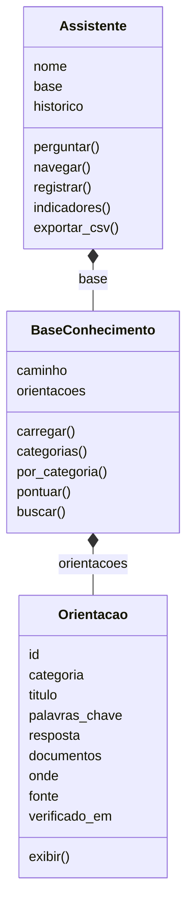

# Citizen Assist AI 🇧🇷

> **Assistente Digital de Orientação ao Cidadão** — Global Solution 2026.2
> Pensamento Computacional e Automação com Python (1CC-PCP) — Desafio CitizenTech

Assistente executado no terminal que responde dúvidas do cidadão **apenas com informações verificadas** em fontes oficiais, mostrando sempre **a fonte, a data da verificação e o aviso de que não é um canal oficial**, e **sem coletar dados pessoais**.

---

## 👤 Integrante

| Nome completo                   | RM     | Modalidade |
| ------------------------------- | ------ | ---------- |
| Alan Júnior Araújo de Souza     | 574112 | Individual |

---

## 🎯 Público e problema escolhidos

**Público-alvo:** jovens no **primeiro emprego** e **cidadãos em geral** que precisam tirar documentos básicos, entender direitos trabalhistas e sociais e economizar na conta de luz.

**Problema:** a informação sobre como tirar o CPF, a nova identidade (CIN), o título de eleitor, a Carteira de Trabalho Digital, o Cartão SUS ou a Tarifa Social de Energia **existe, mas está espalhada**, escrita em linguagem técnica e muitas vezes misturada com sites que *parecem* oficiais e não são (inclusive golpes que cobram por serviços gratuitos). O jovem que vai procurar o primeiro emprego costuma precisar de vários desses documentos ao mesmo tempo e não sabe por onde começar.

**Solução:** um assistente em Python que:

- carrega uma base de conhecimento em JSON com **16 orientações reais em 4 categorias**;
- responde perguntas em **texto livre** com uma **busca por pontuação** e nível de confiança;
- permite **navegar por categorias** com menus numerados;
- informa **documentos necessários, onde ir, fonte oficial e data de verificação**;
- **bloqueia dados pessoais** (CPF, RG, telefone, e-mail) e nunca os registra;
- registra cada atendimento, calcula **6 indicadores** e **exporta CSV**.

---

## 🌍 ODS relacionados

| ODS | Como o projeto contribui |
| --- | --- |
| **ODS 10 – Redução das Desigualdades** | Leva informação clara e gratuita sobre documentos e benefícios (CadÚnico, Tarifa Social, seguro-desemprego) a quem tem mais dificuldade de acesso, em linguagem simples. |
| **ODS 11 – Cidades e Comunidades Sustentáveis** | Facilita o acesso a serviços públicos urbanos (UBS, CRAS, Poupatempo, Procon) e orienta sobre consumo consciente de energia. |
| **ODS 16 – Paz, Justiça e Instituições Eficazes** | Aproxima o cidadão das instituições, indica **apenas canais oficiais** (combatendo golpes e sites falsos) e protege a privacidade ao recusar dados pessoais. |
| **ODS 7 – Energia Limpa e Acessível** | Categoria *Energia e Sustentabilidade*: Tarifa Social, bandeiras tarifárias, eficiência energética (Selo Procel) e geração própria de energia solar. |

---

## ▶️ Como executar

**Pré-requisito:** Python 3.8 ou superior. **Nenhuma biblioteca externa** é necessária — o projeto usa somente a biblioteca padrão (`json`, `csv`, `time`, `os`, `re`, `unicodedata`, `datetime`).

```bash
git clone https://github.com/alansouza1/citizen-assist-ai.git
cd citizen-assist-ai
python main.py        # no Linux/macOS pode ser necessário usar: python3 main.py
```

O programa pode ser executado de qualquer pasta (`python caminho/para/main.py`), pois o `main.py` ajusta o diretório de trabalho para encontrar a pasta `data/`.

### Menu principal

```text
========== MENU PRINCIPAL ==========
1 - Fazer uma pergunta
2 - Navegar por categorias
3 - Ver indicadores de atendimento
4 - Exportar atendimentos para CSV
0 - Sair
```

Ao escolher **0 - Sair**, o assistente pede uma **nota de facilidade de 1 a 5** (ou 0 para voltar ao menu). Todas as subtelas aceitam **0 para voltar**.

---

## 🗂️ Estrutura do projeto

```text
citizen-assist-ai/
├── README.md                  # este documento
├── main.py                    # menu principal e fluxo do programa
├── orientacao.py              # classe Orientacao
├── base_conhecimento.py       # classe BaseConhecimento + normalizar()
├── assistente.py              # classe Assistente (atendimento, histórico, indicadores, CSV)
└── data/
    ├── base_conhecimento.json # 16 orientações verificadas
    ├── historico.json         # atendimentos registrados (começa como [])
    └── atendimentos.csv       # exportação dos atendimentos (começa só com o cabeçalho)
```

### Classes e composição

As classes se encaixam por **composição**: o `Assistente` *tem uma* `BaseConhecimento`, que *tem uma lista* de objetos `Orientacao`.

```text
Assistente
 └── base: BaseConhecimento
      └── orientacoes: [Orientacao, Orientacao, Orientacao, ...]
```



| Classe | Arquivo | Atributos | Métodos principais | Responsabilidade |
| --- | --- | --- | --- | --- |
| `Orientacao` | `orientacao.py` | `id`, `categoria`, `titulo`, `palavras_chave`, `resposta`, `documentos`, `onde`, `fonte`, `verificado_em` | `exibir()`, `de_dicionario()` | Guardar uma orientação e exibi-la **sempre** com fonte, data de verificação e aviso “este assistente NÃO é um canal oficial”. |
| `BaseConhecimento` | `base_conhecimento.py` | `caminho`, `orientacoes` (lista de `Orientacao`) | `carregar()`, `categorias()`, `por_categoria()`, `pontuar()`, `buscar()`, `confianca()` | Ler o JSON (sem travar se ausente/corrompido), listar categorias e buscar a melhor orientação. |
| `Assistente` | `assistente.py` | `nome`, `base` (`BaseConhecimento`), `historico` | `perguntar()`, `navegar()`, `registrar()`, `indicadores()`, `exibir_indicadores()`, `exportar_csv()`, `avaliar()` | Conversar com o cidadão, guardar o histórico, calcular indicadores e exportar o CSV. |

Uso no `main.py`:

```python
base = BaseConhecimento("data/base_conhecimento.json")
base.carregar()                 # lê o JSON e cria os objetos Orientacao

assistente = Assistente("Citizen Assist AI", base)
assistente.perguntar()          # usa base.buscar() e orientacao.exibir()
```

---

## 📚 Base de conhecimento (`data/base_conhecimento.json`)

Lista de dicionários, um por orientação, com **todos os campos obrigatórios**: `id`, `categoria`, `titulo`, `palavras_chave` (mínimo 3), `resposta` (linguagem simples), `documentos` (lista), `onde`, `fonte` (URL oficial) e `verificado_em` (`"2026-11-16"`).

```json
{
    "id": 9,
    "categoria": "Saúde e Cidadania",
    "titulo": "Fazer o Cartão Nacional de Saúde (Cartão SUS)",
    "palavras_chave": ["cartao sus", "cartao do sus", "sus", "cns", "cartao nacional de saude"],
    "resposta": "O Cartão SUS é gratuito. Se você nunca fez, vá a uma Unidade Básica de Saúde (UBS) ...",
    "documentos": ["Documento de identificação com foto", "CPF", "Comprovante de residência"],
    "onde": "Qualquer UBS (posto de saúde) ou aplicativo Meu SUS Digital",
    "fonte": "https://www.gov.br/saude/pt-br/composicao/seidigi/meususdigital",
    "verificado_em": "2026-11-16"
}
```

| Categoria | ID | Orientação |
| --- | --- | --- |
| **Documentação** | 1 | Tirar o CPF pela primeira vez |
| | 2 | Tirar a Carteira de Identidade Nacional (CIN), o novo RG |
| | 3 | Tirar o primeiro título de eleitor |
| | 4 | Fazer o alistamento militar obrigatório |
| **Trabalho e Renda** | 5 | Obter a Carteira de Trabalho Digital |
| | 6 | Ser Jovem Aprendiz (Aprendizagem Profissional) |
| | 7 | Pedir o seguro-desemprego |
| | 8 | Consultar e entender o FGTS |
| **Saúde e Cidadania** | 9 | Fazer o Cartão Nacional de Saúde (Cartão SUS) |
| | 10 | Tomar vacinas gratuitas e atualizar a caderneta |
| | 11 | Inscrever a família no Cadastro Único (CadÚnico) |
| | 12 | Reclamar de uma compra com problema (direitos do consumidor) |
| **Energia e Sustentabilidade** | 13 | Tarifa Social de Energia Elétrica: desconto na conta de luz |
| | 14 | Entender as bandeiras tarifárias da conta de luz |
| | 15 | Economizar energia e escolher aparelhos eficientes (Selo Procel) |
| | 16 | Gerar a própria energia solar em casa (geração distribuída) |

> As respostas foram escritas a partir das páginas oficiais listadas em [Fontes consultadas](#-fontes-consultadas), conferidas em **16/11/2026**. Nenhuma informação foi inventada; quando um detalhe varia por estado (ex.: onde emitir a CIN), a resposta indica o órgão responsável em vez de supor.

---

## 🧮 Regra de pontuação (busca inteligente por regras)

A “inteligência” do assistente é baseada em **regras**: a pergunta é comparada com **cada** orientação, que recebe pontos; a de maior pontuação é exibida.

### 1. Normalização — `normalizar(texto)`

Pergunta, palavras-chave e título são comparados **em minúsculas, sem acentos e sem pontuação**:

1. `lower()` e `strip()`;
2. `unicodedata.normalize("NFKD", ...)` separa a letra do acento (`ã` → `a` + `~`) e os acentos são descartados;
3. `re.sub(r"[^a-z0-9]+", " ", ...)` troca qualquer pontuação/símbolo por espaço;
4. o resultado recebe **um espaço em cada ponta**: `" como faco o cartao do sus "`.

Os espaços nas pontas fazem a busca encontrar apenas **palavras/expressões inteiras** — assim a palavra-chave `"sus"` **não** pontua dentro de `"suspenso"`, e `"rg"` não pontua dentro de `"cargo"`.

### 2. Pontos — `pontuar(pergunta, orientacao)`

| Regra | Pontos |
| --- | --- |
| Cada **palavra-chave** da orientação que aparece na pergunta normalizada | **+3** |
| Cada **palavra da pergunta com 4 letras ou mais** que aparece no **título** normalizado (cada palavra conta uma única vez) | **+1** |

### 3. Confiança

| Pontuação da melhor orientação | Resultado |
| --- | --- |
| **6 ou mais** | Confiança **ALTA** |
| **3 a 5** | Confiança **MÉDIA** |
| **menos de 3** | **“Não encontrei”** → o assistente sugere outras palavras e lista as categorias |

### 4. Resultado — `buscar(pergunta)`

Devolve uma **lista de tuplas `(pontos, orientacao)`** ordenada da **maior para a menor** pontuação (orientações com 0 ponto ficam de fora; em empate, vence o menor `id`). O assistente exibe a **melhor** orientação e **até 2 alternativas** — só são sugeridas alternativas com pelo menos 3 pontos, para não mostrar resultados sem relação com a dúvida.

### 5. Exemplos reais de cálculo

**“Como faço o cartão do SUS?”** → normalizada: `" como faco o cartao do sus "`

| Orientação 9 – *Fazer o Cartão Nacional de Saúde (Cartão SUS)* | Pontos |
| --- | --- |
| palavra-chave `cartao do sus` encontrada | +3 |
| palavra-chave `sus` encontrada | +3 |
| palavra-chave `cartao sus` (não aparece junta: há “do” no meio) | 0 |
| palavra `cartao` (6 letras) está no título | +1 |
| `como`, `faco` não estão no título | 0 |
| **Total** | **7 → ALTA** |

**“Como faço a carteira de trabalho digital”** → orientação 5 (*Obter a Carteira de Trabalho Digital*): `carteira de trabalho` (+3) + `carteira de trabalho digital` (+3) + `carteira`, `trabalho`, `digital` no título (+1 +1 +1) = **9 pontos → ALTA**.

**“fui demitido”** → orientação 7: palavra-chave `demitido` (+3) = **3 pontos → MÉDIA**.

**“conta de luz”** → maior pontuação: 1 ponto (`conta` aparece nos títulos 13 e 14) → **“Não encontrei”**, com sugestão de palavras e categorias.

Os pesos e limites ficam em constantes no topo de `base_conhecimento.py` (`PONTOS_PALAVRA_CHAVE`, `PONTOS_PALAVRA_TITULO`, `TAMANHO_MINIMO_PALAVRA`, `LIMITE_ALTA`, `LIMITE_MEDIA`), o que facilita ajustes.

---

## 🛡️ Regras de atendimento

- **Dados pessoais:** o assistente **nunca pede** nome, CPF, telefone ou e-mail. Qualquer pergunta com **8 ou mais dígitos** seguidos ou formatados (ex.: `12345678`, `123.456.789-00`, `12.345.678-9`, `(11) 91234-5678`) ou com o caractere **`@`** é **recusada na hora**, com aviso para reescrever, e **não é salva** no `historico.json`. A verificação usa a expressão regular `\d(?:[\s.\-/()]*\d){7,}` e é repetida dentro de `registrar()` como segunda barreira.
- **Entradas inválidas:** letras onde se espera número, opção fora da faixa, entrada vazia e resposta s/n inválida mostram uma mensagem e pedem de novo — o programa **nunca encerra nem mostra traceback** (inclusive `Ctrl+C` / fim de entrada encerram com uma mensagem amigável).
- **Navegação:** categorias e orientações numeradas, com **“0 para voltar”** em todas as telas.
- **Transparência:** toda resposta mostra **fonte**, **data de verificação** e o aviso **“Aviso: este assistente NÃO é um canal oficial.”**
- **Arquivos:** `base_conhecimento.json` ausente ou corrompido (`FileNotFoundError` / `JSONDecodeError`) não trava o programa — ele avisa e continua com o menu. Registros com campos faltando são ignorados. Um `historico.json` corrompido é preservado como `historico.json.corrompido` e um novo histórico é iniciado.

---

## 📊 Histórico, indicadores e CSV

Cada atendimento válido é salvo em `data/historico.json`. O tempo é medido com `inicio = time.time()` no começo do atendimento e `round(time.time() - inicio, 1)` ao final.

| Campo | Tipo | Significado |
| --- | --- | --- |
| `data` | texto | Data e hora do registro (`AAAA-MM-DD HH:MM:SS`) |
| `origem` | texto | `"pergunta"` (texto livre) ou `"categoria"` (navegação) |
| `pergunta` | texto | Pergunta digitada (ou `[Categoria] Título` na navegação) |
| `id_orientacao` | int / `null` | Orientação exibida (`null` se não encontrou) |
| `encontrou` | bool | Se alguma orientação foi encontrada/exibida |
| `ajudou` | bool | Resposta do cidadão a “Essa orientação respondeu sua dúvida?” |
| `tentativas` | int | Quantas buscas/orientações foram necessárias no atendimento |
| `tempo_segundos` | float | Duração do atendimento em segundos |
| `sessao` | texto | *(extra)* Identifica a execução do programa, sem dados pessoais |
| `nota_facilidade` | int / `null` | *(extra)* Nota de 1 a 5 dada ao sair |

**Como as tentativas são contadas:** na pergunta livre, cada pergunta válida digitada e cada alternativa aberta contam 1 tentativa; se não encontrar ou não ajudar, a pessoa pode tentar de novo com outras palavras dentro do mesmo atendimento. Na navegação, cada orientação aberta conta 1 tentativa, até uma delas ajudar.

### Os 6 indicadores (menu 3)

| Indicador | Cálculo |
| --- | --- |
| **Resposta encontrada (%)** | atendimentos com `encontrou = true` ÷ total × 100 |
| **Tempo médio para encontrar** | média de `tempo_segundos` dos atendimentos em que a resposta foi encontrada |
| **Facilidade de uso (1 a 5)** | média das notas dadas ao sair (uma nota por sessão) |
| **Taxa de acerto: ajudou (%)** | atendimentos com `ajudou = true` ÷ total × 100 |
| **Tentativas por atendimento** | média de `tentativas` |
| **Lista de dúvidas sem solução** | perguntas com `ajudou = false`, marcadas como *não encontrada* ou *não ajudou* |

### Exportação (menu 4)

Todos os atendimentos são gravados em `data/atendimentos.csv` com `csv.DictWriter`, colunas:
`data, sessao, origem, pergunta, id_orientacao, encontrou, ajudou, tentativas, tempo_segundos, nota_facilidade`.

---

## 💻 Exemplo de execução

```text
Digite sua dúvida (0 para voltar): Como faço o cartão do SUS?

Confiança da resposta: ALTA (7 pontos)

>> Fazer o Cartão Nacional de Saúde (Cartão SUS) [Saúde e Cidadania]
O Cartão SUS é gratuito. Se você nunca fez, vá a uma Unidade Básica de Saúde (UBS) com seus
documentos para se cadastrar. Se já tem cadastro, pode ver o número e o cartão digital no
aplicativo Meu SUS Digital, entrando com a conta gov.br.
Documentos necessários:
  - Documento de identificação com foto
  - CPF
  - Comprovante de residência
Onde: Qualquer UBS (posto de saúde) ou aplicativo Meu SUS Digital
Fonte: https://www.gov.br/saude/pt-br/composicao/seidigi/meususdigital (verificado em 2026-11-16)
Aviso: este assistente NÃO é um canal oficial.

Essa orientação respondeu sua dúvida? (s/n): s
(Atendimento registrado: 9.4 s, 1 tentativa(s).)

Digite sua dúvida (0 para voltar): meu cpf é 123.456.789-00
Atenção: não digite CPF, RG, telefone, e-mail ou outros dados pessoais.
Sua mensagem foi recusada e NÃO foi registrada. Reescreva a dúvida sem dados pessoais.
```

---

## 🔗 Integrações com outras disciplinas

- **Energia e Sustentabilidade → SERS (integração futura):** a categoria *Energia e Sustentabilidade* (Tarifa Social, bandeiras tarifárias, eficiência energética e energia solar) foi criada já pensando na integração futura com o **SERS**. Como a base é um JSON simples e a classe `BaseConhecimento` é independente da interface, novas orientações ou dados vindos desse projeto podem ser adicionados sem alterar a lógica de busca. *Status: planejada, ainda não implementada.*
- A busca por pontuação descrita acima continua sendo o mecanismo principal avaliado em PCP.

---

## 📖 Fontes consultadas

Todas conferidas em **16/11/2026**:

| Tema | Fonte oficial |
| --- | --- |
| CPF | https://www.gov.br/pt-br/servicos/inscrever-no-cpf |
| Carteira de Identidade Nacional (CIN) | https://www.gov.br/governodigital/pt-br/identidade/cin/carteira-de-identidade-nacional-cin |
| Título de eleitor | https://www.tse.jus.br/servicos-eleitorais/autoatendimento-eleitoral |
| Alistamento militar | https://www.gov.br/defesa/pt-br/assuntos/servico-militar |
| Carteira de Trabalho Digital | https://www.gov.br/pt-br/servicos/obter-a-carteira-de-trabalho |
| Aprendizagem Profissional | https://www.gov.br/trabalho-e-emprego/pt-br/assuntos/aprendizagem-profissional |
| Seguro-desemprego | https://www.gov.br/pt-br/servicos/solicitar-o-seguro-desemprego |
| FGTS | https://www.gov.br/trabalho-e-emprego/pt-br/servicos/trabalhador/fgts |
| Cartão SUS / Meu SUS Digital | https://www.gov.br/saude/pt-br/composicao/seidigi/meususdigital |
| Vacinação | https://www.gov.br/saude/pt-br/vacinacao |
| Cadastro Único | https://www.gov.br/mds/pt-br/acoes-e-programas/cadastro-unico |
| Direitos do consumidor | https://www.consumidor.gov.br |
| Tarifa Social de Energia Elétrica | https://www.gov.br/aneel/pt-br/assuntos/tarifas/tarifa-social |
| Bandeiras tarifárias | https://www.gov.br/aneel/pt-br/assuntos/tarifas/bandeiras-tarifarias |
| Eficiência energética (Selo Procel) | https://smartseloprocel.procelinfo.com.br/selo-procel |
| Micro e minigeração distribuída | https://www.gov.br/aneel/pt-br/assuntos/geracao-distribuida |

Documentação técnica: [documentação oficial do Python](https://docs.python.org/pt-br/3/) — módulos `json`, `csv`, `re`, `unicodedata`, `time`, `datetime` e `os`.

---

## 🧪 Resultado do teste com usuários

> Teste realizado com **3 pessoas de fora da equipe**, somando **12 atendimentos**. **Nenhum nome ou dado pessoal dos participantes foi registrado** — as pessoas são identificadas apenas como Participante A, B e C.

**Data do teste:** 16/11/2026

### Participantes e atendimentos

| Participante | Perfil (sem dados pessoais) | Nº de atendimentos | Nota de facilidade (1 a 5) |
| --- | --- | --- | --- |
| Participante A | Jovem em busca do primeiro emprego | 4 | 5 |
| Participante B | Cidadão buscando documentos e benefícios trabalhistas | 4 | 4 |
| Participante C | Morador interessado em programas sociais e economia de energia | 4 | 5 |
| **Total** | — | **12** | — |

### Indicadores obtidos (menu 3)

| Indicador | Resultado |
| --- | --- |
| Resposta encontrada (%) | 91.7% |
| Tempo médio para encontrar | 7.7 s |
| Facilidade de uso (1 a 5) | 4.7 (3 avaliações) |
| Taxa de acerto: ajudou (%) | 91.7% |
| Tentativas por atendimento | 1.1 |

### Dúvidas sem solução

- `como tirar passaporte (não encontrada)`

### Melhoria feita a partir do teste

| Problema observado | Melhoria aplicada | Resultado após a melhoria |
| --- | --- | --- |
| Durante a sessão 2, a pergunta `"como tirar segunda via"` somou apenas 1 ponto e não foi encontrada, exigindo uma 2ª tentativa com `"como tirar o rg"` | Inclusão dos sinônimos `"segunda via"` e `"2a via"` nas `palavras_chave` da orientação 2 (*Carteira de Identidade Nacional — CIN*) no `data/base_conhecimento.json` | A pergunta `"como tirar segunda via"` passou a somar 4 pontos e ser encontrada diretamente com confiança **MÉDIA** |

---

## ⚠️ Limitações

- **Busca por regras, não por significado:** o assistente só entende palavras que estão nas palavras-chave ou nos títulos. Sinônimos não cadastrados (ex.: “conta de luz” sozinha) e erros de digitação (“cartao do sos”) não são reconhecidos.
- **Palavras genéricas no título:** como a regra dá +1 para qualquer palavra de 4+ letras presente no título, palavras comuns (ex.: “tirar”, “conta”) podem somar pontos em orientações não relacionadas — por isso o limite mínimo de 3 pontos e alternativas só a partir de 3 pontos.
- **Base pequena e estática:** 16 orientações, revisadas manualmente. Regras de programas públicos mudam (ex.: Tarifa Social, calendário eleitoral); a data `verificado_em` deixa claro quando cada informação foi conferida e a base precisa de revisão periódica.
- **Informações gerais, nacionais:** detalhes que variam por estado ou município (órgão emissor da CIN, endereço do CRAS) são indicados de forma geral.
- **Bloqueio de dados pessoais por padrão:** perguntas legítimas com 8+ dígitos seguidos (ex.: um número de protocolo) também são recusadas; dados pessoais escritos sem números (ex.: um nome) não são detectados — por isso o assistente também orienta a não digitar nenhum dado pessoal.
- **Interface só em terminal**, sem acessibilidade por voz, e o histórico fica em um arquivo local (sem uso simultâneo por várias pessoas).
- **Não é canal oficial:** o assistente apenas orienta e indica os canais oficiais; ele não emite documentos nem consulta sistemas do governo.

---

## 🎥 Vídeo técnico

📺 **Link do vídeo no YouTube (não listado):** [https://youtu.be/UPMCnBZ7b4c](https://youtu.be/UPMCnBZ7b4c)

Roteiro: equipe, público e problema → registro do JSON (dicionários e tuplas) → classes, `self` e composição → `normalizar()` e `pontuar()` com o cálculo de uma pergunta real → execução (pergunta encontrada, não encontrada, entrada inválida, dado pessoal bloqueado, navegação por categoria) → alteração ao vivo de uma palavra-chave no JSON → `historico.json`, CSV e indicadores do teste → uma decisão técnica e uma limitação.
